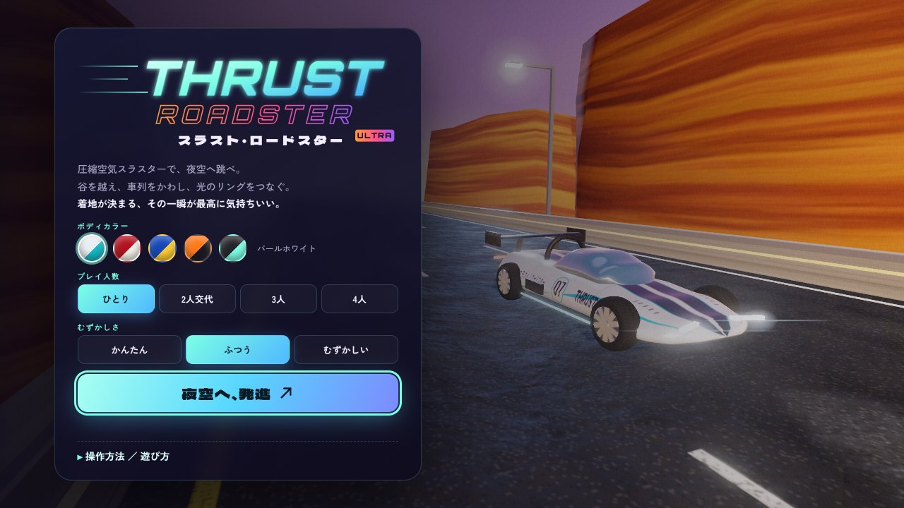
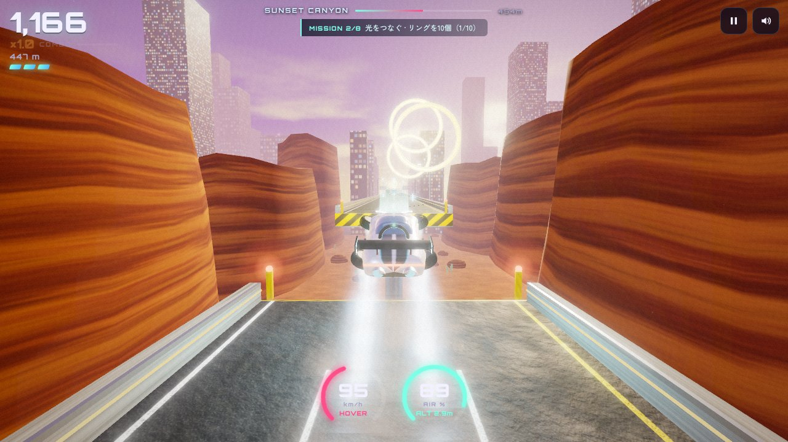
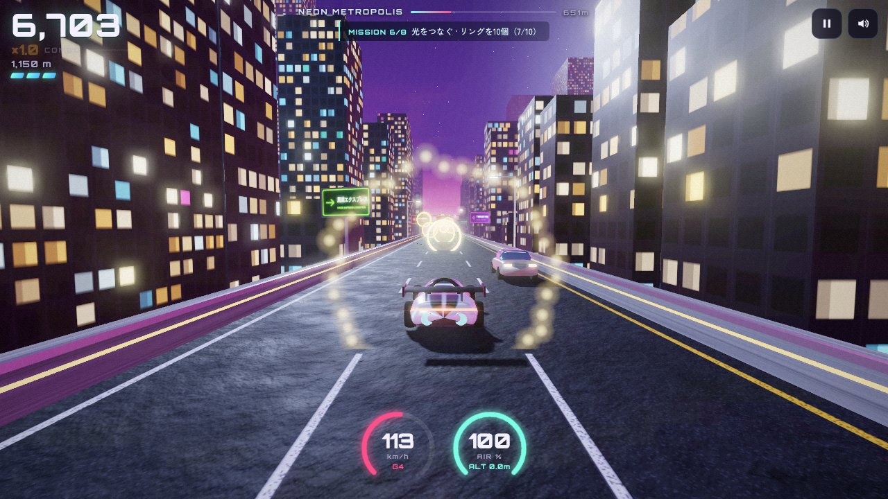
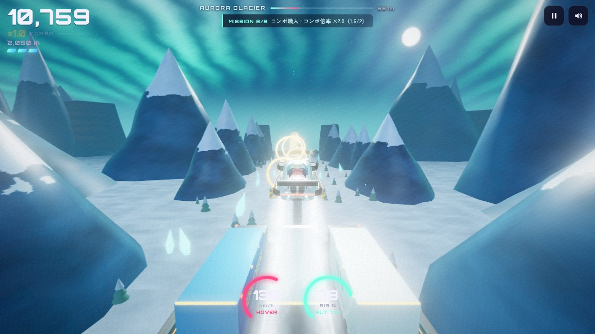

# スラスト・ロードスター ULTRA

圧縮空気スラスターで夜空へ跳ぶ、3Dドライブ・アクション。
谷を越え、車列をかわし、光のリングをつなぎ、着地を決める。



| 夕焼けキャニオン | ネオン・メトロポリス | オーロラ氷河 |
|---|---|---|
|  |  |  |

## 遊び方
`index.html` をブラウザで開くだけ（ビルド不要・オフライン可。Three.jsを同梱）。

| 操作 | キーボード | スマホ | ゲームパッド |
|---|---|---|---|
| ジャンプ／上昇 | Space・↑・W（長押しで上昇） | 右下「噴射」 | A |
| ハンドル | ← → / A D | 画面左側を左右スライド | 左スティック／十字 |
| ブースト | Shift・X | 「BOOST」 | RT・X |
| 一時停止 | P・Esc | II ボタン | Start |

- 空中では**着地点ガイド**を表示：緑＝安全／黄＝衝撃大／赤＝落下・激突
- 着地直前の短い噴射で衝撃が和らぎ **パーフェクト着地**
- 空中でハンドルを倒し続けると **バレルロール**、車の真横をすり抜けると **ニアミス**。連続技でコンボ倍率アップ
- 900mごとにゾーンが変わり、景色・BGMの調・テンポが切り替わる

## 前作からの主な改善
- **操作性**：横移動を約3倍に高速化して反応性を向上、タップ1回で即ジャンプ、空中長押しで上昇、落下中の噴射は強いリバース噴射に。崖際のコヨーテタイム（猶予）、ガードレールで場外落下なし、着地点予測ガイド、スライド式のタッチハンドル、ゲームパッド対応
- **映像**：HDR＋ブルーム＋ACESトーンマップ、リアルタイム影、環境マップ反射（クリアコート塗装）、速度に応じた放射ブラー、色収差、手続き生成テクスチャ（アスファルト、看板、ビル窓、コンテナ、塗装リバリー）。3つのゾーンは空シェーダー（雲・太陽・月・星・オーロラ）付き
- **車体**：ロフト曲面のボディ、ガラスキャノピー、カーボンのリアウイング。空中ではホイールが水平に折りたたまれて噴射する**ホバーモード**。ボディカラーは5色から選択
- **音**：すべてWeb Audioでリアルタイム合成。ギアチェンジするエンジン音、タービン音、噴射音、アフターバーナー、風・タイヤ音。リバーブとディレイ付きの効果音、ゾーンごとに調が変わるシンセウェーブBGM（空中ではキックが抜ける）
- **その他**：レースシグナルのカウントダウン、8つのミッション、ランク評価（S〜C）、1〜4人交代プレイ、画質の自動調整

## 構成
```
index.html          画面・HUD
css/style.css       UI
js/textures.js      Canvasによる手続きテクスチャ
js/models.js        車・障害物・景観の3Dモデル
js/world.js         空・ゾーン・照明・コース生成
js/fx.js            パーティクル・着地ガイド・天候
js/audio.js         サウンドエンジンとBGMシーケンサー
js/game.js          物理・入力・カメラ・ゲーム進行
js/vendor/          three.js r147（MIT）
legacy/             前バージョン
```

## ライセンス
本作品は [クリエイティブ・コモンズ 表示 - 非営利 - 改変禁止 4.0 国際（CC BY-NC-ND 4.0）](https://creativecommons.org/licenses/by-nc-nd/4.0/deed.ja) で提供されます。全文は [LICENSE](LICENSE) を参照してください。

- **表示**：作者名とライセンスを明記すれば共有できます
- **非営利**：営利目的での利用はできません
- **改変禁止**：改変したものを配布することはできません

同梱の three.js（`js/vendor/`）は本ライセンスの対象外で、MITライセンスに従います。
